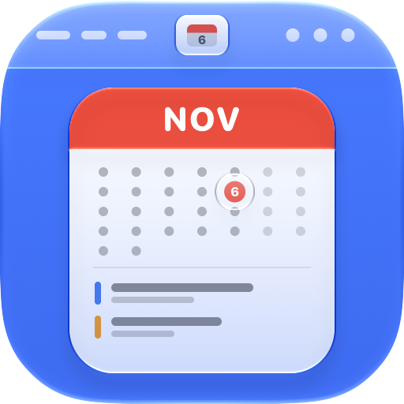
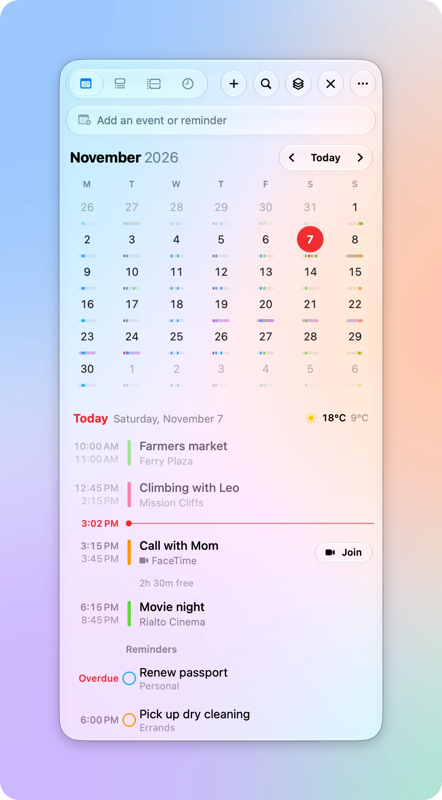
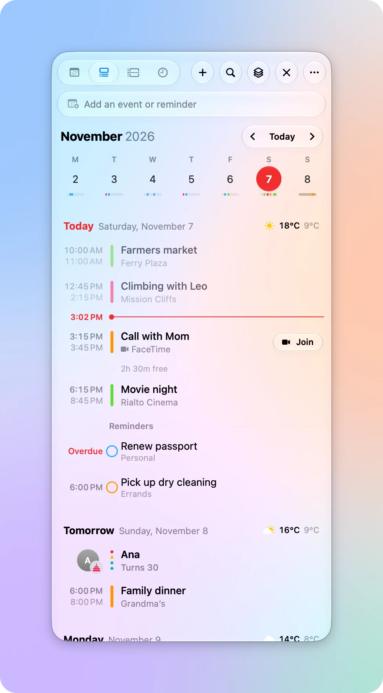
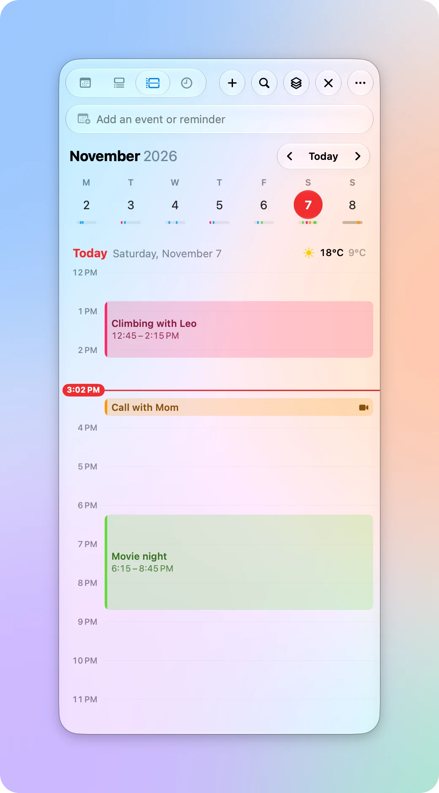
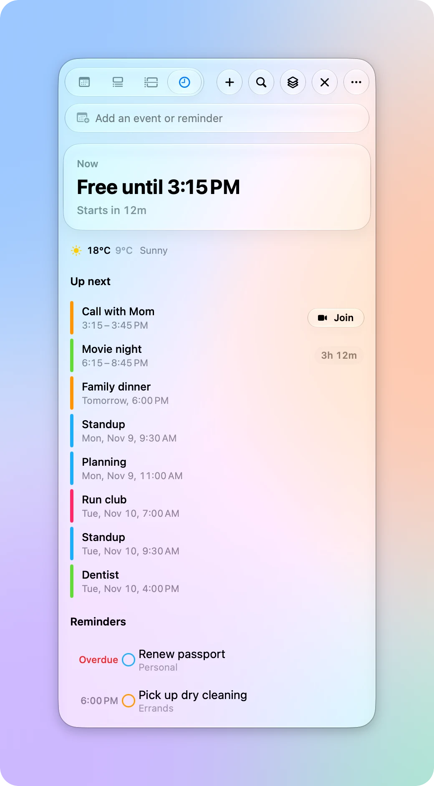
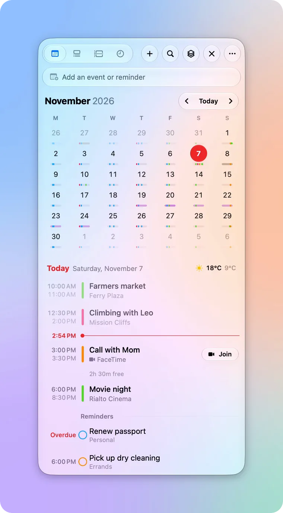
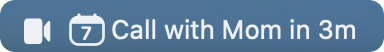
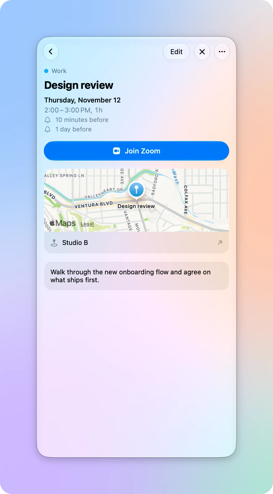
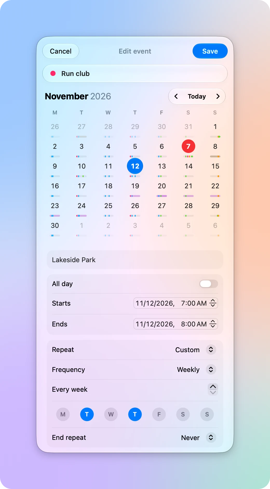

<p align="center">
  <picture>
    <source media="(prefers-color-scheme: dark)" srcset=".github/assets/icon-dark.png">
    
  </picture>
</p>

<h1 align="center">Daybar</h1>

<p align="center">Your calendar in the menu bar, one click away.</p>

<p align="center">
  <a href="https://github.com/firatciftci/daybar/releases/latest"><b>Download for macOS</b></a>
  &nbsp;·&nbsp;
  <a href="https://github.com/firatciftci/daybar/actions/workflows/ci.yml"></a>
</p>

<p align="center">
  <picture>
    <source media="(prefers-color-scheme: dark)" srcset=".github/assets/month-dark.webp">
    
  </picture>
</p>

Daybar puts today's date in your menu bar. Click it to see your month, week, or day, check what's next, and add events by typing them the way you'd say them. It uses the calendars and reminders already on your Mac, so there's no account to create and nothing to sync.

## Highlights

### Four ways to see your time

Month, Week, Day, and Up next, with weather, birthdays, and reminders next to your events. Up next shows what's happening now and how long you're free.

<table>
  <tr>
    <td>
      <picture>
        <source media="(prefers-color-scheme: dark)" srcset=".github/assets/week-dark.webp">
        
      </picture>
    </td>
    <td>
      <picture>
        <source media="(prefers-color-scheme: dark)" srcset=".github/assets/day-dark.webp">
        
      </picture>
    </td>
    <td>
      <picture>
        <source media="(prefers-color-scheme: dark)" srcset=".github/assets/upnext-dark.webp">
        
      </picture>
    </td>
  </tr>
  <tr>
    <td align="center">Week</td>
    <td align="center">Day</td>
    <td align="center">Up next</td>
  </tr>
</table>

### Add events by typing

Type a sentence and press Return. Daybar colors the date, place, and calendar as it recognizes them, and previews the event before adding it.

<p align="center">
  <picture>
    <source media="(prefers-color-scheme: dark)" srcset=".github/assets/quick-add-dark.webp">
    
  </picture>
</p>

| You type | Daybar adds |
| --- | --- |
| `Lunch with Sam tomorrow at noon` | An event tomorrow from 12 to 1 PM |
| `Standup every Monday 9:30am for 15m /work` | A weekly 15-minute event in your Work calendar |
| `Dentist Nov 14 3pm at Main St Dental alert 1h` | An event with a location and an alert an hour before |
| `Flight to Istanbul Dec 20` | An all-day event |
| `remind me to call the bank Friday` | A reminder due Friday |

Start with `remind`, `todo`, or `task` to add a reminder instead. Add `/name` to pick a calendar or list by the start of its name.

### Your next event in the menu bar

<p align="center">
  
</p>

The title of your next event and a countdown sit next to the date, then switch to the time left once it starts. When a Zoom, Teams, Meet, Webex, or FaceTime call is about to start, click the camera to join.

### Edit without leaving the panel

<table>
  <tr>
    <td>
      <picture>
        <source media="(prefers-color-scheme: dark)" srcset=".github/assets/detail-dark.webp">
        
      </picture>
    </td>
    <td>
      <picture>
        <source media="(prefers-color-scheme: dark)" srcset=".github/assets/editor-dark.webp">
        
      </picture>
    </td>
  </tr>
</table>

Create, edit, duplicate, and delete events, including repeating ones, with your calendar still in view. Set custom repeats like every Tuesday and Thursday, add up to five alerts, and undo any change with ⌘Z.

### And more

- Reminders: overdue and upcoming reminders sit with your events, and you can check them off there.
- Weather: daily forecasts from Apple Weather for where you are or a city you choose.
- Birthdays and attendees: names and photos from Contacts.
- Calendar sets: group calendars into sets like Work and Home, then switch between them.
- Search: find events by title, place, notes, or calendar.
- Shortcuts and Focus: add events and get what's next from Shortcuts and Siri, and choose which calendars show during each Focus.

## Install

Daybar needs macOS 27 or later.

1. Download `Daybar.dmg` from the [latest release](https://github.com/firatciftci/daybar/releases/latest).
2. Open it and drag Daybar to your Applications folder.
3. Open Daybar and allow access to your calendars when macOS asks.

Daybar updates itself. Each release is signed with a Developer ID, notarized by Apple, and has a build attestation you can check:

```sh
gh attestation verify Daybar.dmg --repo firatciftci/daybar
```

## Keyboard shortcuts

| Shortcut | Action |
| --- | --- |
| <kbd>⌥</kbd><kbd>⌘</kbd><kbd>K</kbd> | Show or hide Daybar from anywhere (change it in Settings) |
| <kbd>⌘</kbd><kbd>1</kbd> to <kbd>⌘</kbd><kbd>4</kbd> | Switch between Month, Week, Day, and Up next |
| <kbd>⌘</kbd><kbd>T</kbd> | Go to today |
| <kbd>⌘</kbd><kbd>N</kbd> | New event |
| <kbd>⌘</kbd><kbd>F</kbd> | Search |
| <kbd>⌘</kbd><kbd>E</kbd> | Edit the open event |
| <kbd>⌘</kbd><kbd>↩</kbd> | Save the event you're editing, or join the open event's call |
| <kbd>⌘</kbd><kbd>⌫</kbd> | Delete the open event |
| <kbd>⌘</kbd><kbd>[</kbd> | Go back |
| <kbd>⌘</kbd><kbd>Z</kbd> and <kbd>⇧</kbd><kbd>⌘</kbd><kbd>Z</kbd> | Undo or redo the last change to your calendar |
| <kbd>Tab</kbd> and <kbd>⇧</kbd><kbd>Tab</kbd> | Move between fields while editing |
| <kbd>Esc</kbd> | Leave a field, close search, or close the panel |

## Privacy

Daybar has no accounts, analytics, or servers of its own. Your events, reminders, and contacts stay on your Mac and are read through Apple's frameworks. Weather requests send your approximate location, or the city you chose, to Apple Weather. If Apple Weather is unavailable, they go to [Open-Meteo](https://open-meteo.com) instead. Update checks go to GitHub. If you turn off weather and automatic update checks in Settings, Daybar only goes online when you check for updates yourself.

## Build from source

You need Xcode 27 and [Homebrew](https://brew.sh).

```sh
git clone https://github.com/firatciftci/daybar.git
cd daybar
brew bundle
xcodegen generate
open Daybar.xcodeproj
```

The Xcode project is generated from `project.yml`, so change that file instead of the project settings and run `xcodegen generate` again. To build without a signing team, pass `CODE_SIGNING_ALLOWED=NO` to `xcodebuild`. Weather needs a signed build with the WeatherKit capability.

To see sample events instead of your own, for example when taking screenshots, launch with `-demo`. Add `-light` or `-dark` to pick an appearance. Nothing you do in demo mode touches your calendars.

```sh
open Daybar.app --args -demo -dark
```

Before you open a pull request, run the same checks as CI:

```sh
tools/check.sh
```

See [CONTRIBUTING.md](CONTRIBUTING.md) for more.

## License

[MIT](LICENSE)
